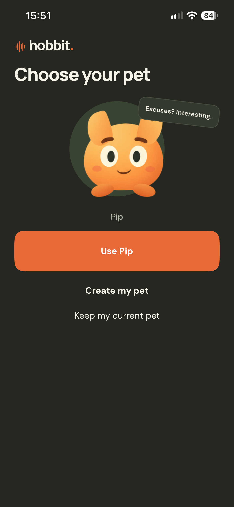
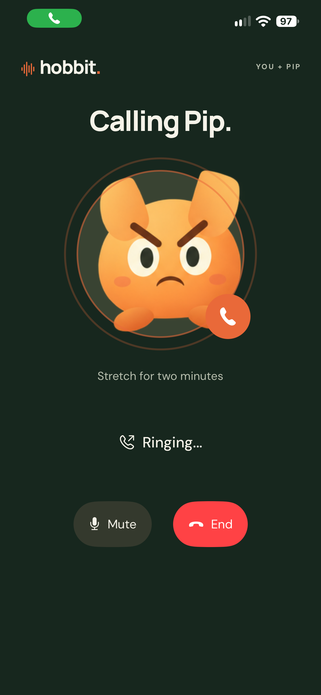
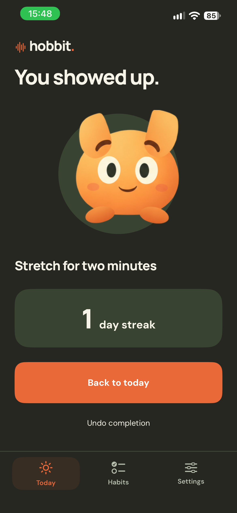

# Hobbit

A native iPhone habit companion. Sign in with ChatGPT, choose Pip or create your own pet, add daily habits with their own call times, then talk with your pet and save your progress. Gentle, Aggressive and Unhinged coaching modes change both the voice and the animated character's expression.

The complete journey is pet selection, spoken or typed first-habit setup, editable confirmation, daily calls, voice coaching, completion, a saved streak and undo. Fixed Today, Habits and Settings tabs fit the main screens on the tested iPhone without vertical scrolling. Habits are paginated; each has its own coaching mode, daily call, pause state and progress. Settings includes pet selection, reduced pet movement, call controls and permissions. The app uses the approved dark olive design with bundled Manrope and DM Sans fonts.

Public source: [github.com/sgaabdu4/hobbit](https://github.com/sgaabdu4/hobbit). The Xcode project and bundle identifier retain the earlier Habitaker name to preserve installed sign-in and push registration.

[Watch the 89-second demo](docs/demo.mp4). Three recorded voices, a tiny drill sergeant, real iPhone footage and a complete habit journey. The separate recorded API response is labelled. [Demo notes and live skit](DEMO.md) explain exactly what is shown.

  

Verified on a physical iPhone on 1 November 2026: OAuth returned through the phone's loopback listener, signed identity validation passed, and ChatGPT-plan permission was granted. Pet onboarding runs on the device. GPT Image 2.5 generated the bundled original pet and expression sheet. Device voice diagnostics confirmed microphone input, received audio, input/output transcript events and loudspeaker routing; the tester heard the pet. A scheduled incoming push reached an active voice session after a device-lock command. The system lock-screen UI was not captured.

## Set up the development demo

1. Install Node 26.12.0 and Xcode 27.2. An Apple Developer Program team and physical iPhone are needed for push calls.
2. Copy `.env.example` to `.env`. Add an OpenAI project key with Images, Live, Decisions and Responses access. Sign-in alone does not fund every API feature.
3. Register your app bundle ID with Push Notifications in Apple Developer. Create a sandbox APNs key scoped to that app. Save its `.p8` file outside Git and fill the APNs fields in `.env`.
4. Run `npm run prepare:device`. This creates a local HTTPS certificate and pairs the development build with this Mac. The certificate and pairing secret are ignored by Git.
5. Run `npm start`. Keep the Mac awake and the phone on the same Wi-Fi. No public tunnel is used.
6. In Xcode, set your team and bundle ID, then run on the phone. Allow local network and microphone access when requested. Test foreground voice first, then schedule a call and lock the phone.

The project pins WebRTC 156.0.0. Xcode resolves it automatically. No npm packages are required. The phone pins the generated TLS certificate and sends a device pairing token to this development server. This is a single-device hackathon setup, not a public multi-user backend. Never distribute a build containing your development pairing secret.

Calls are capped at three minutes in the app. Daily habits, time zones, pause states and completed days are stored under `.local/schedule.json` and survive server restarts. The previous single habit migrates with its history intact. Call times must be at least five minutes apart. Daily scheduling uses calendar dates in each habit's time zone, including daylight-saving changes. A missed call time while the Mac is asleep is skipped rather than replayed in a burst. The separate 15-second test call is temporary and is lost on server restart. Keep the Mac awake and the server running for daily calls. Apple controls the incoming-call screen; pet animations appear inside Hobbit.

An explicit completion or request to hang up stops the live model response. The app plays one brief, bundled closing line in the selected voice and ends the system call after playback. The End button remains immediate. Generate these original clips with `node --env-file=.env scripts/create-call-endings.mjs`; this uses billable GPT-Live generation and the configured custom Unhinged voice.

Pet creation asks for a creature, colour and optional details, then previews the generated result before saving. New pets use a transparent 4-by-4 PNG atlas. Rows are calm, stern, furious and happy; columns are closed mouth, small open mouth, wide open mouth and blink. Existing 2-by-2 custom pets remain compatible. There is no file-import step. Speaking frames follow actual received audio amplitude with smoothing; this approximates mouth motion rather than phoneme-level lip sync. Blinks and restrained body movement respect Reduce Motion. Cosmetic transcript decisions cannot mark the habit done; completion uses a separate explicit-action decision or the visible "I did it" button and can be undone.

The reusable [Hobbit pet skill](.agents/skills/hobbit-pets/SKILL.md) documents generation, validation and integration. It is independent of ChatGPT Work's pet creation skill. Spoken setup uses GPT-Live to collect the request, then a structured GPT-6 Luna Responses result fills an editable draft. Nothing is scheduled until the user confirms it.

For a custom Unhinged voice, enable Voices read/write on the project key and run `npm run create:voice` once. This creates a new original synthetic voice, saves its ID under `.local`, and preserves its design prompt in `server/voice-design.mjs`. Restart the server to use it. An existing voice ID can instead be set as `OPENAI_UNHINGED_VOICE_ID`. Without a custom voice, stronger modes use Vesper; Gentle uses Marin. Vocal delivery varies and needs listening tests.

## Run the sign-in check

1. Open `Habitaker.xcodeproj` in Xcode 27.2 or later.
2. Choose your Apple development team under Signing & Capabilities.
3. Select a paired iPhone running iOS 18 or later and run Hobbit.
4. Tap **Continue with ChatGPT**. Complete OpenAI's sign-in and consent flow on the phone.
5. A successful test opens pet onboarding only after verifying the identity signature, issuer, audience, expiry and nonce.

No API key is required for this OAuth check. Credentials and the stable host identifier stay in the iPhone Keychain. The app writes a nonsecret `Documents/verification.json` report containing test stages and permission booleans. It never writes tokens, authorization codes, email addresses or account identifiers to that report. Voice diagnostics contain connection states, event counts and audio levels, never recordings or transcript text.

## Verification scope

- Open-source registration uses OpenAI's documented dynamic client flow, PKCE and an HTTP listener bound to `127.0.0.1` on the phone.
- Apple's authentication browser stays open during authorization. After receiving the loopback callback, the local listener redirects to an internal completion scheme to close that browser. This mobile combination needs a real-device test; documentation alone is not proof it works.
- ChatGPT plan permission is reported separately from identity verification. Inference has not been tested.
- The product will generate an app-specific pet. Automatic ChatGPT pet-library access is no longer a requirement. The documented identity and Responses scopes do not establish access to that library.
- Native UI tests passed on the signed-in physical iPhone: typed habit setup, saving the daily call, completion, persistence after relaunch, undo, pet selection without replacement, and opening the habit editor. A second habit was added and completed independently, survived relaunch, and was removed through two confirmations while preserving the original habit. All three bottom tabs and Settings controls were reachable without scrolling.
- Expired sign-in was caught during device testing. The app now renews the saved session using the documented rotating refresh token, validates the renewed identity, and saves the replacement in Keychain.
- Foreground voice transport and loudspeaker routing were checked on the phone. The Mac command triggered a real incoming call; the physical-device test answered it, reached Live voice, completed the habit and returned to completion. Playback diagnostics confirmed the entire farewell finished before the system call ended. Pet generation, angry expressions and talking previews passed on the phone. Lock-screen presentation and saving/relaunching a generated custom pet have not been checked end to end.
- The physical iPhone resolved the bundled font families as Manrope and DM Sans. Dark Today, calling and completion screens were captured and inspected. Native UI checks verified that actual received speech opens Pip's mouth.
- The ringing screen pulses around Pip until received audio begins. Device diagnostics confirmed that ringback starts and stops and that output uses the built-in loudspeaker.
- A synthetic spoken "I don't want to do it" was sent through GPT-Live with the actual Unhinged configuration and custom voice. Pip challenged the delay and gave a ten-second first step. Eight live Decisions checks distinguished reluctance from an explicit request to stop and from completion.

Run `swift test` for OAuth validation, daily completion and streak rollover, and audio-to-mouth animation logic. Run `npm test` for habit validation, separation of cosmetic and completion decisions, and daily scheduling across clock changes. The `HobbitUITests` Xcode scheme runs the native UI checks on an already-signed-in iPhone. The separate `HobbitDemo` scheme explicitly opts into a billable live voice check and keeps its screen recording.

Run `node --env-file=.env scripts/check-coaching.mjs` for the eight billable Decisions checks. An optional path to a synthetic mono PCM16LE 24 kHz recording also tests the live spoken response and saves its audio under `.local`. Use a synthetic recording saying "I don't want to do it"; never a private conversation. This check is separate from offline CI.

## Sources and credits

Created during the DevDay Exchange London hackathon on 1 November 2026 with Codex. Codex implemented and tested the OAuth signature/callback checks and adapted the documented GPT-Live transport to native Swift WebRTC and CallKit. No third-party application template is used. The original Pip artwork was generated using GPT Image 2.5 Sunburst through the bundled Codex Imagegen CLI. Prompts and originals are in `output/imagegen`; app copies are in `Sources/Habitaker/Resources`.

Concrete debugging example: when calls connected silently, Codex added diagnostics without speech recordings, found that WebRTC had selected the earpiece, and changed the WebRTC audio configuration to use the loudspeaker. A second phone run confirmed the speaker route with live input and output events. The original double-ring sound is synthesized by `scripts/generate-ringback.py`; it uses no third-party recording. The app repeats it while connecting and stops it when speech begins or the call ends.

The original custom drill-sergeant voice was created with OpenAI prompt-to-voice. Its voice description and clean sample script are in `server/voice-design.mjs`. No real person's recording or imitation was used. Each developer creates their own saved voice or supplies an authorized voice ID.

The selected orange Pip atlas and app icon were generated with GPT Image 2.5 Sunburst from the approved original design. The earlier sprite draft was generated with Codex's built-in image tool. Prompts and generated artwork are in `output/imagegen`. Manrope and DM Sans come from the [Google Fonts repository](https://github.com/google/fonts); their SIL Open Font Licenses are bundled in `Sources/Habitaker/Resources/Fonts`.

The [WebRTC Swift package](https://github.com/stasel/WebRTC) supplies Google's WebRTC binary under its upstream BSD license. Keep its license notices with redistributed builds. Apple's CallKit and PushKit provide system calling integration. The OpenAI pet sprite concept informed the app-specific state mapping; no ChatGPT user pet or library asset is bundled.

- [OpenAI open-source sign-in](https://developers.openai.com/siwc/token-sharing-open-source/sign-in)
- [OpenAI identity validation](https://developers.openai.com/siwc/website)
- [ChatGPT plan limitations](https://developers.openai.com/siwc/token-sharing-open-source/preview-limitations)
- [ChatGPT pets](https://learn.chatgpt.com/docs/pets)
- [Apple web authentication](https://developer.apple.com/documentation/authenticationservices/aswebauthenticationsession)
- [OpenAI GPT-Live WebRTC](https://developers.openai.com/api/docs/guides/voice-webrtc?api=live)
- [OpenAI Decisions voice integration](https://developers.openai.com/api/docs/guides/decisions-voice)
- [OpenAI image generation](https://developers.openai.com/api/docs/guides/image-generation)
- [Apple VoIP push handling](https://developer.apple.com/documentation/pushkit/responding-to-voip-notifications-from-pushkit)

OpenAI project credentials stay on the backend. Do not commit credentials, signing material or personal device data. Do not include account screens, keys or personal habit text in the demo video. Run `npm test` for the server's focused habit/mode/decision checks, and `swift test` for OAuth checks.
